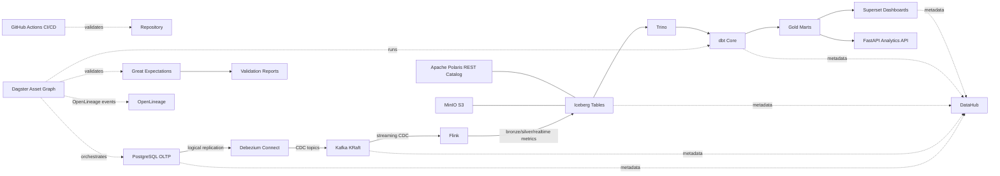

# OpenLake Commerce Platform

OpenLake Commerce Platform is a local, open-source modern data engineering project for an ecommerce and customer data platform use case. It is designed to cover CDC ingestion, stream processing, lakehouse storage, open table formats, SQL federation, dimensional modeling, orchestration, data quality, metadata, BI, API serving, and CI/CD without paid cloud services.

**This is a work in progress. The full stack has not been run end to end** (see [Project Status](#project-status)).

Target design: operational Postgres tables change continuously, Debezium captures row-level changes into Kafka KRaft, Flink processes CDC and behavioral events into Iceberg tables on MinIO through Polaris, Trino queries the lakehouse, dbt builds marts, Dagster orchestrates assets, Great Expectations validates critical datasets, OpenLineage/DataHub document metadata flow, Superset visualizes metrics, and FastAPI serves analytics endpoints.

## Project Status

The repository has never been run end to end. Docker was not available on the machine it was written on, so none of the containers, the CDC flow, the Flink job, dbt, Great Expectations, Dagster, or Superset have been exercised against real services.

### Works today (verified without Docker)

- **Data generator** (`src/data_generator/`), with unit tests. The Postgres schema and seed (`infra/postgres/init.sql`, `scripts/init_postgres.py`) are written but have not been run against a database.
- **FastAPI analytics API** (`src/api/`). Tests run it against an in-memory fake repository; the real repository queries Trino.
- **Unit tests** (`python -m pytest`), **ruff**, a static smoke test (`scripts/smoke_test.py --static`), and `docker compose config` validation, all run in GitHub Actions CI.

### Not working / work in progress

- **Silver layer is incomplete.** `dbt/models/sources/sources.yml` declares 9 silver tables (customers, products, campaigns, orders, order_items, payments, shipments, inventory, clickstream_events), but `scripts/create_iceberg_tables.sql` and the Flink SQL only create `silver.orders`, `silver.payments`, and `silver.inventory`. Six of the nine staging models (and the marts built on them) therefore have no source table to read from.
- **Flink job cannot run as configured.** `flink_jobs/jobs/commerce_streaming_job.py` is a PyFlink job, but the stock `flink:1.20.0` image has no Python/PyFlink, and the Kafka and Iceberg connector JARs are not included (`infra/flink/lib/` is empty; see [flink_jobs/README.md](flink_jobs/README.md)).
- **Great Expectations check is broken.** The checkpoint YAML uses the pre-1.0 (V0) config format, while `pyproject.toml` pins `great-expectations>=1.0`, and `scripts/run_quality_checks.py` calls the `great_expectations checkpoint run` CLI, which was removed in GE 1.0.
- **Dagster** (`dagster_project/definitions.py`) defines assets that shell out to the scripts above, plus an asset job and an hourly schedule. No sensors exist; `dagster_project/sensors/README.md` lists suggestions only.
- **OpenLineage** is README-only: `openlineage-python` is an optional dependency, but no code emits lineage events.
- **Superset**: `superset/dashboards/openlake_commerce_dashboard.yaml` is a hand-written description of planned pages, not a Superset export, so it cannot be imported.
- **`make up` is not enough for the API.** The `core` profile starts Postgres, Kafka, Debezium, and the API, but Trino is in the `lakehouse` profile, so every endpoint except `/health` fails until `lakehouse` is also started (and tables exist).
- **Runtime smoke test is not implemented.** `scripts/smoke_test.py` only supports `--static`.

## Design Goals

- Use CDC (Debezium) instead of batch CSV loading.
- Use Kafka KRaft, not ZooKeeper-era Kafka.
- Model bronze, silver, and gold Iceberg tables with partitioning and time-travel-ready design.
- Cover ecommerce domains: customers, products, orders, payments, shipments, inventory, clickstream, campaigns, and support tickets (all present in the Postgres source schema).
- Go beyond SQL: Docker Compose profiles, retry scripts, tests, CI checks, contracts, lineage, quality gates, and API serving.

## Architecture

Target architecture. Several parts are not working yet; see [Project Status](#project-status).



## Tech Stack

| Layer | Technology | Purpose |
| --- | --- | --- |
| Source | PostgreSQL, Python | OLTP schema, seed data, realistic continuous changes |
| CDC | Debezium | Change capture from Postgres logical replication |
| Streaming | Kafka KRaft, Flink | Durable event log and near-real-time metrics |
| Lakehouse | MinIO, Iceberg, Polaris | Local object storage, open table format, REST catalog |
| Query | Trino | SQL federation over Iceberg |
| Transform | dbt Core | Staging, intermediate, dimensions, facts, marts |
| Orchestration | Dagster | Asset-based pipeline orchestration |
| Quality | Great Expectations | Critical data quality gates and reports |
| Metadata | OpenLineage, DataHub | Lineage and searchable catalog |
| BI/API | Superset, FastAPI | Dashboards and low-latency metric endpoints |
| DevOps | Docker Compose, GitHub Actions | Local profiles, CI checks, repeatability |

## Local Setup

Copy environment defaults:

```bash
cp .env.example .env
```

Start the lightweight core:

```bash
make up
make seed
make register-connector
make topics
```

On Windows without `make`, use:

```powershell
./scripts/dev.ps1 up
./scripts/dev.ps1 seed
./scripts/dev.ps1 register-connector
./scripts/dev.ps1 topics
```

Start heavier profiles as needed:

```bash
docker compose --profile streaming up -d
docker compose --profile lakehouse up -d
docker compose --profile quality up -d
docker compose --profile bi up -d
docker compose -f docker-compose.yml -f docker-compose.full.yml --profile full up -d
```

> Note: `make up` starts only the `core` profile. The API needs Trino, which is in the `lakehouse` profile.

> This workstation currently does not have Docker or Make installed. The repository includes the commands and checks, and `scripts/dev.ps1` gives PowerShell equivalents once Docker Desktop, Rancher Desktop, or Podman-compatible Compose is available.

## Service URLs

| Service | URL |
| --- | --- |
| FastAPI | http://localhost:8000/docs |
| Kafka external listener | localhost:29092 |
| Debezium Connect | http://localhost:8083 |
| Flink UI | http://localhost:8081 |
| MinIO console | http://localhost:9001 |
| Polaris | http://localhost:8181 |
| Trino | http://localhost:8080 |
| Dagster | http://localhost:3000 |
| Superset | http://localhost:8088 |
| DataHub | http://localhost:9002 |

## Run Each Layer

```bash
# Not yet verified end to end; flink-job and ge-check are known to fail (see Project Status).
make seed                 # Create operational sample data
make generate             # Continuously simulate orders, payments, shipments, inventory, clicks
make register-connector   # Register Debezium PostgreSQL connector
make topics               # Create/validate CDC topics
make flink-job            # Submit streaming job
make dbt-run              # Build dimensional and mart models
make dbt-test             # Run dbt tests
make ge-check             # Run Great Expectations critical checks
make dagster              # Start Dagster UI
make superset             # Start Superset
make smoke                # Run static repo smoke checks
```

## Query With Trino

```sql
SELECT order_date, gross_revenue
FROM iceberg.gold.mart_daily_revenue
ORDER BY order_date DESC
LIMIT 14;
```

More examples live in [infra/trino/examples.sql](infra/trino/examples.sql). Mart columns are documented in [dbt/models/marts/schema.yml](dbt/models/marts/schema.yml).

## Validate The Pipeline

Run the static checks first:

```bash
python -m pytest
python -m ruff check
python scripts/smoke_test.py --static
docker compose config
```

Not implemented yet: runtime validation (Postgres row counts, Debezium connector state, Kafka topics, Iceberg namespaces, dbt tests, Great Expectations checkpoints, API health). `scripts/smoke_test.py` currently only supports `--static`.

## Dashboard Pages

Planned. `superset/dashboards/openlake_commerce_dashboard.yaml` lists the intended pages, but it is not a Superset export and cannot be imported; no charts have been built yet:

- Executive revenue overview
- Realtime order monitoring
- Payment health
- Campaign performance
- Customer 360
- Inventory risk
- Data quality monitoring

## Legacy Stack Comparison

Design intent; see [Project Status](#project-status) for what is actually working.

| Legacy Pattern | OpenLake Pattern |
| --- | --- |
| Batch CSV drops | Debezium CDC with durable Kafka topics |
| ZooKeeper Kafka | Kafka KRaft |
| Hive tables | Iceberg tables with schema evolution and time travel |
| HDFS-only storage | S3-compatible MinIO |
| Airflow task DAG focus | Dagster asset graph |
| Stored procedures/manual SQL | dbt documented transformations and tests |
| Manual data checks | Great Expectations checkpoints |
| No lineage | OpenLineage and DataHub metadata |
| BI-only output | BI plus FastAPI analytics serving |

## Troubleshooting

- If Kafka clients cannot connect from the host, use `localhost:29092`; containers use `kafka:9092`.
- If Debezium has no events, confirm Postgres started with `wal_level=logical` and the connector is registered.
- If Trino cannot see Iceberg tables, start `lakehouse` profile and run `scripts/create_iceberg_tables.sql`.
- If the full profile is slow, start `core`, `streaming`, `lakehouse`, `quality`, `catalog`, and `bi` separately.

## Future Improvements

- Add production Helm charts.
- Add Prometheus/Grafana operational monitoring.
- Add an Iceberg compaction job.
- Add a schema registry and Avro/Protobuf contracts.
- Add contract testing between API responses and dbt marts.
