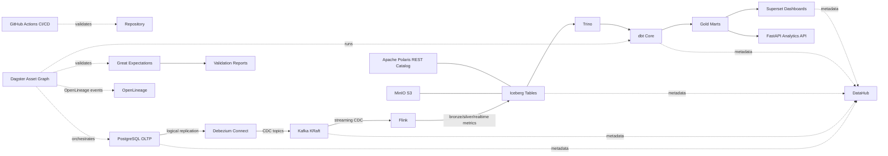

# OpenLake Commerce Platform

OpenLake Commerce Platform is a local, open-source modern data engineering project for an ecommerce and customer data platform use case. It demonstrates CDC ingestion, stream processing, lakehouse storage, open table formats, SQL federation, dimensional modeling, orchestration, data quality, metadata, BI, API serving, and CI/CD without paid cloud services.

The project is intentionally production-style: operational Postgres tables change continuously, Debezium captures row-level changes into Kafka KRaft, Flink processes CDC and behavioral events into Iceberg tables on MinIO through Polaris, Trino queries the lakehouse, dbt builds marts, Dagster orchestrates assets, Great Expectations validates critical datasets, OpenLineage/DataHub document metadata flow, Superset visualizes metrics, and FastAPI serves analytics endpoints.

## Why This Is Portfolio-Ready

- Shows modern CDC instead of batch CSV loading.
- Uses Kafka KRaft, not ZooKeeper-era Kafka.
- Models bronze, silver, and gold Iceberg tables with partitioning and time-travel-ready design.
- Includes real ecommerce domains: customers, products, orders, payments, shipments, inventory, clickstream, campaigns, and support tickets.
- Demonstrates engineering beyond SQL: Docker Compose profiles, retry scripts, tests, CI, contracts, lineage, quality gates, and API serving.
- Is easy to explain in interviews because every layer maps to a business problem.

## Architecture



## Tech Stack

| Layer | Technology | Purpose |
| --- | --- | --- |
| Source | PostgreSQL, Python | OLTP schema, seed data, realistic continuous changes |
| CDC | Debezium | Change capture from Postgres logical replication |
| Streaming | Kafka KRaft, Flink | Durable event log and near-real-time metrics |
| Lakehouse | MinIO, Iceberg, Polaris | Local object storage, open table format, REST catalog |
| Query | Trino | SQL federation over Iceberg |
| Transform | dbt Core | Staging, intermediate, dimensions, facts, marts |
| Orchestration | Dagster | Asset-based pipeline orchestration |
| Quality | Great Expectations | Critical data quality gates and reports |
| Metadata | OpenLineage, DataHub | Lineage and searchable catalog |
| BI/API | Superset, FastAPI | Dashboards and low-latency metric endpoints |
| DevOps | Docker Compose, GitHub Actions | Local profiles, CI checks, repeatability |

## Local Setup

Copy environment defaults:

```bash
cp .env.example .env
```

Start the lightweight core:

```bash
make up
make seed
make register-connector
make topics
```

On Windows without `make`, use:

```powershell
./scripts/dev.ps1 up
./scripts/dev.ps1 seed
./scripts/dev.ps1 register-connector
./scripts/dev.ps1 topics
```

Start heavier profiles as needed:

```bash
docker compose --profile streaming up -d
docker compose --profile lakehouse up -d
docker compose --profile quality up -d
docker compose --profile bi up -d
docker compose -f docker-compose.yml -f docker-compose.full.yml --profile full up -d
```

> This workstation currently does not have Docker or Make installed. The repository includes the commands and checks, and `scripts/dev.ps1` gives PowerShell equivalents once Docker Desktop, Rancher Desktop, or Podman-compatible Compose is available.

## Service URLs

| Service | URL |
| --- | --- |
| FastAPI | http://localhost:8000/docs |
| Kafka external listener | localhost:29092 |
| Debezium Connect | http://localhost:8083 |
| Flink UI | http://localhost:8081 |
| MinIO console | http://localhost:9001 |
| Polaris | http://localhost:8181 |
| Trino | http://localhost:8080 |
| Dagster | http://localhost:3000 |
| Superset | http://localhost:8088 |
| DataHub | http://localhost:9002 |

## Run Each Layer

```bash
make seed                 # Create operational sample data
make generate             # Continuously simulate orders, payments, shipments, inventory, clicks
make register-connector   # Register Debezium PostgreSQL connector
make topics               # Create/validate CDC topics
make flink-job            # Submit streaming job
make dbt-run              # Build dimensional and mart models
make dbt-test             # Run dbt tests
make ge-check             # Run Great Expectations critical checks
make dagster              # Start Dagster UI
make superset             # Start Superset
make smoke                # Run static repo smoke checks
```

## Query With Trino

```sql
SELECT order_date, gross_revenue
FROM iceberg.gold.mart_daily_revenue
ORDER BY order_date DESC
LIMIT 14;
```

More examples live in [docs/data-model.md](docs/data-model.md) and [infra/trino/examples.sql](infra/trino/examples.sql).

## Validate The Pipeline

Run the static checks first:

```bash
python -m pytest
python -m ruff check
python scripts/smoke_test.py --static
docker compose config
```

Runtime validation then checks Postgres row counts, Debezium connector state, Kafka topics, Iceberg namespaces, dbt tests, Great Expectations checkpoints, and API health.

## Dashboard Pages

Superset assets under `superset/dashboards/` define starter dashboards for:

- Executive revenue overview
- Realtime order monitoring
- Payment health
- Campaign performance
- Customer 360
- Inventory risk
- Data quality monitoring

## Legacy Stack Comparison

| Legacy Pattern | OpenLake Pattern |
| --- | --- |
| Batch CSV drops | Debezium CDC with durable Kafka topics |
| ZooKeeper Kafka | Kafka KRaft |
| Hive tables | Iceberg tables with schema evolution and time travel |
| HDFS-only storage | S3-compatible MinIO |
| Airflow task DAG focus | Dagster asset graph |
| Stored procedures/manual SQL | dbt documented transformations and tests |
| Manual data checks | Great Expectations checkpoints |
| No lineage | OpenLineage and DataHub metadata |
| BI-only output | BI plus FastAPI analytics serving |

## Troubleshooting

- If Kafka clients cannot connect from the host, use `localhost:29092`; containers use `kafka:9092`.
- If Debezium has no events, confirm Postgres started with `wal_level=logical` and the connector is registered.
- If Trino cannot see Iceberg tables, start `lakehouse` profile and run `scripts/create_iceberg_tables.sql`.
- If the full profile is slow, start `core`, `streaming`, `lakehouse`, `quality`, `catalog`, and `bi` separately.

## Future Improvements

- Add production Helm charts.
- Add Prometheus/Grafana operational monitoring.
- Add an Iceberg compaction job.
- Add a schema registry and Avro/Protobuf contracts.
- Add contract testing between API responses and dbt marts.

## CV Bullet Points

- Built an end-to-end local ecommerce lakehouse with PostgreSQL CDC, Debezium, Kafka KRaft, Flink, Iceberg, Polaris, MinIO, Trino, dbt, Dagster, Great Expectations, DataHub, Superset, and FastAPI.
- Designed bronze/silver/gold Iceberg layers and dimensional marts for revenue, customer 360, campaign performance, payment health, and inventory risk.
- Implemented synthetic operational workload generation, CDC connector automation, data contracts, quality gates, lineage documentation, Docker Compose profiles, and CI checks.
